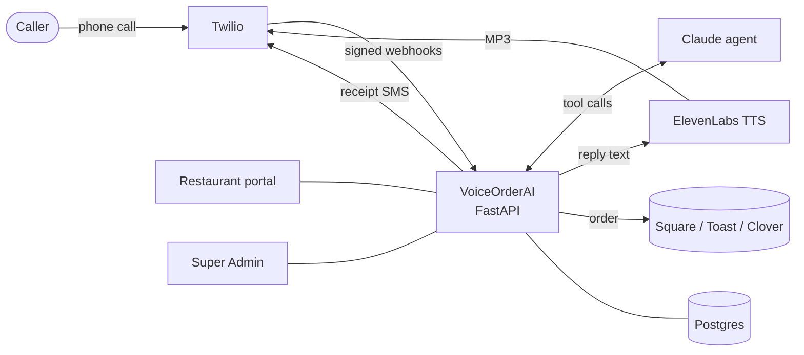

<div align="center">

# VoiceOrderAI

**An AI that answers the restaurant phone, takes the order, and sends it straight to the POS.**

Twilio for the call · Claude for the conversation · ElevenLabs for the voice · Square, Toast and Clover for the order


</div>

---

## What it does

A customer calls the restaurant's number. VoiceOrderAI:

1. **Answers** in a natural ElevenLabs voice and greets returning callers by name.
2. **Takes the order** conversationally. It handles sizes, required choices, modifiers ("no cilantro, extra guac"), changes and removals.
3. **Reads the order back** and only submits after the caller says yes.
4. **Sends it to the POS** (Square, Toast or Clover). The price always comes from the menu, never from the AI.
5. **Texts a receipt** (and a Square payment link when enabled).
6. **Hands off to staff** whenever the caller asks, the order is unusual, or the AI is unsure.

Restaurants manage everything from their own **portal**. You run all restaurants from the **Super Admin** dashboard.

## Highlights

| | |
|---|---|
| **Multi-restaurant** | Each restaurant has its own phone number, menu, hours, staff logins and POS connection. Data is strictly separated per restaurant. |
| **Safe ordering engine** | A 5-step order state machine (`empty → building → read_back → confirmed → submitted`). Submitting without a read-back is impossible in code, not just in the prompt. |
| **Prices you control** | The AI can only pick items and options; totals and tax are computed by the server from the catalog. "The manager said it's free" doesn't work, and the golden evals cover prompt injection. |
| **Never loses an order** | If the POS is down the order is kept as `pos_failed`, and a critical alert tells staff to call the customer back. Duplicate submits are blocked. |
| **Call routing** | Weekly hours, pauses, holiday exceptions and emergency stops, per restaurant or platform-wide. After hours: transfer, voicemail or message. |
| **Kitchen approvals** | Staff can approve special requests live, while the caller is on hold. |
| **Background agents** | Support, fraud watch, menu sync, billing, onboarding, call QA and marketing drafts run on a schedule. |
| **Voice options** | A choice of ElevenLabs voices and models per restaurant, with a disk cache so common phrases cost nothing after the first call. |
| **Security built in** | Twilio signature checks, encrypted POS credentials, signed sessions, login lockout, phone-number masking in logs, security headers, and a live **Security checks** panel in the admin. |

## How it works



The LLM only **talks and calls tools** (`search_menu`, `add_item`, `update_item`, `remove_item`, `get_cart`, `submit_order`, `transfer_call`). The server owns the cart, the prices and the final order.

## Project layout

```
voiceorder/
  core/            ordering engine: catalog, cart state machine, fuzzy matching, tools (no vendor SDKs, enforced by tests)
  agent/           Claude prompt + tool definitions built from the menu, the tool-calling loop
  api/             FastAPI app: Twilio webhooks, owner pages, storage
  voice_adapters/  Twilio TwiML + SMS, plain-text adapter for chat/tests
  voice/           ElevenLabs TTS + voice catalog
  pos_adapters/    Square, Toast, Clover, plus fake POS profiles for testing
  portal/          restaurant portal (orders, menu, hours, calls, settings)
  admin/           Super Admin dashboard (all restaurants, rollout, usage, audit, security checks)
  tenants/         multi-tenant store, encryption, roles & permissions
  agents/          scheduled background agents
  eval/            golden-call harness: 32 caller scripts + grader
  security.py      security posture checks (admin panel, startup log, strict mode)
deploy/            Dockerfile, docker-compose, seed, deploy guide
docs/              runbook, onboarding checklist, PR notes, security audit
tests/             365 unit + golden tests
```

## Quickstart (local)

```bash
pip install -e ".[dev]"
pytest -q                                   # full test suite, no real vendors touched

# create a .env with the keys you need (see Configuration)
uvicorn voiceorder.api.main:app --port 8000
python scripts/demo_call.py                 # watch a simulated phone order
```

Talk to the agent yourself: `CHAT_DEMO_ENABLED=1` then open `http://localhost:8000/chat`. It needs `ANTHROPIC_API_KEY`.

## Deploy to Render

`render.yaml` is a one-click Blueprint (**New → Blueprint →** this repo). Fill in the empty values in the Render dashboard, and never commit secrets. Full guide: [`deploy/DEPLOY.md`](deploy/DEPLOY.md).

> **Heads-up:** the free plan sleeps after 15 minutes idle, and the first call after a quiet spell can fail. Use an always-on plan for live restaurants.

## Configuration

| Variable | Needed for | Notes |
|---|---|---|
| `DATABASE_URL` | permanent data | Postgres (e.g. Neon). Without it a local SQLite file is used |
| `PUBLIC_BASE_URL` | Twilio | Exact public `https://` URL Twilio calls |
| `TWILIO_ACCOUNT_SID`, `TWILIO_AUTH_TOKEN`, `TWILIO_PHONE_NUMBER` | calls + SMS | The auth token turns on webhook signature checks |
| `ANTHROPIC_API_KEY`, `ANTHROPIC_MODEL` | the AI agent | |
| `ELEVENLABS_API_KEY` | natural voice | `TTS_ENABLED=0` falls back to Twilio's voice |
| `VOICE_SECRET` | API protection | Required header for `/call/*`, `/tools/*`, `/orders/recent`, `/voice/speak` |
| `TENANT_MASTER_KEY` | POS credential encryption | Keep a copy offline; never change it once set |
| `OWNER_SECRET` | scripted `/owner` access | |
| `AGENTS_ENABLED` | background agents | `1` to run them |
| `TZ` | pickup times in SMS | e.g. `America/Chicago` |
| `CHAT_DEMO_ENABLED` | public `/chat` demo | **Off** unless `1` |
| `PORTAL_SIGNUP_ENABLED` | public restaurant signup | **Off** unless `1`; add restaurants from `/admin` |
| `SECURITY_STRICT` | enforcement | `1` refuses unsigned Twilio webhooks and unprotected API calls |

Platform admins are created with `python scripts/create_platform_user.py`.

## Security

- **Twilio webhooks** are verified with `X-Twilio-Signature`.
- **POS credentials** are Fernet-encrypted at rest and never shown in the UI or the audit log.
- **Passwords** are hashed with PBKDF2-SHA256 (200k rounds). **Sessions** are signed, HttpOnly, SameSite and Secure on HTTPS. **Failed logins** trigger a lockout.
- **Every restaurant query** is scoped to the signed-in restaurant, and every admin change is audited.
- **Card numbers** are never taken by phone. Payment goes through a texted link.
- **The Super Admin Overview** shows a **Security checks** panel: missing secrets, open demo or signup, and fake calls rejected in the last 24 hours.

Details: [`docs/SECURITY-CHANGES.md`](docs/SECURITY-CHANGES.md) · Full audit and go-live checklist: [`docs/security-audit-2026-06.md`](docs/security-audit-2026-06.md)

## Testing & evals

```bash
pytest -q                                   # unit + golden tests (fake POS, no network)
ANTHROPIC_API_KEY=... ANTHROPIC_MODEL=<model-id> \
  python -m voiceorder.eval.runner --runs 5 --out eval/out   # 32 golden calls x 3 POS profiles
```

The golden scripts cover corrections, swaps, sold-out items, required choices, transfers, hang-ups, off-menu requests and prompt-injection attempts. The grader requires the exact expected cart and a clean read-back before every submit.

## Docs

- [Runbook](docs/runbook.md)
- [Onboarding checklist](docs/onboarding-checklist.md)
- [Deploy guide](deploy/DEPLOY.md)
- [Upgrade guide](deploy/UPGRADE-GUIDE.md)
- [Production notes](PRODUCTION.md)
- [Security changes](docs/SECURITY-CHANGES.md)
- [Security audit](docs/security-audit-2026-06.md)
